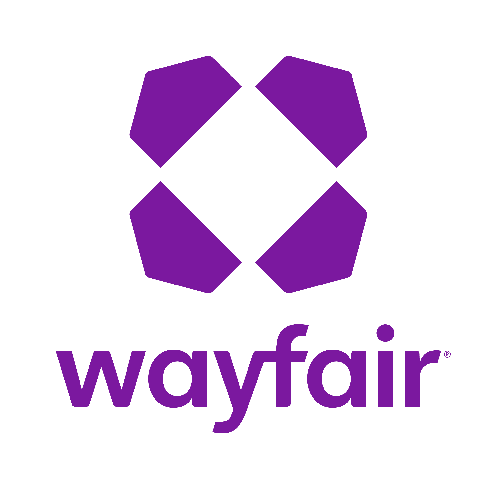
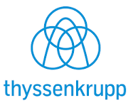
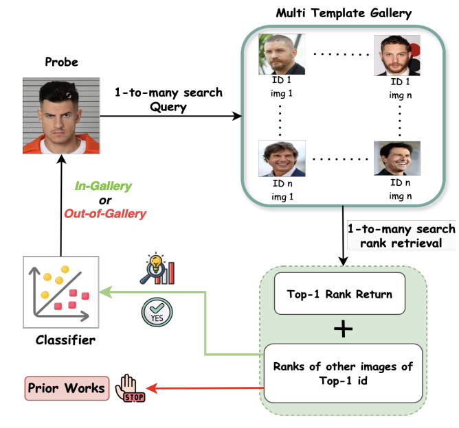
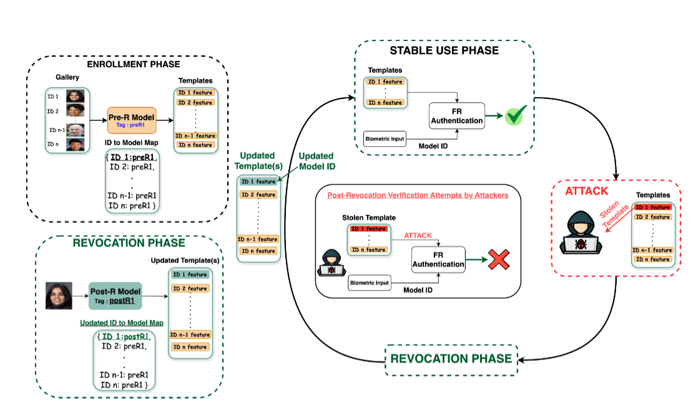
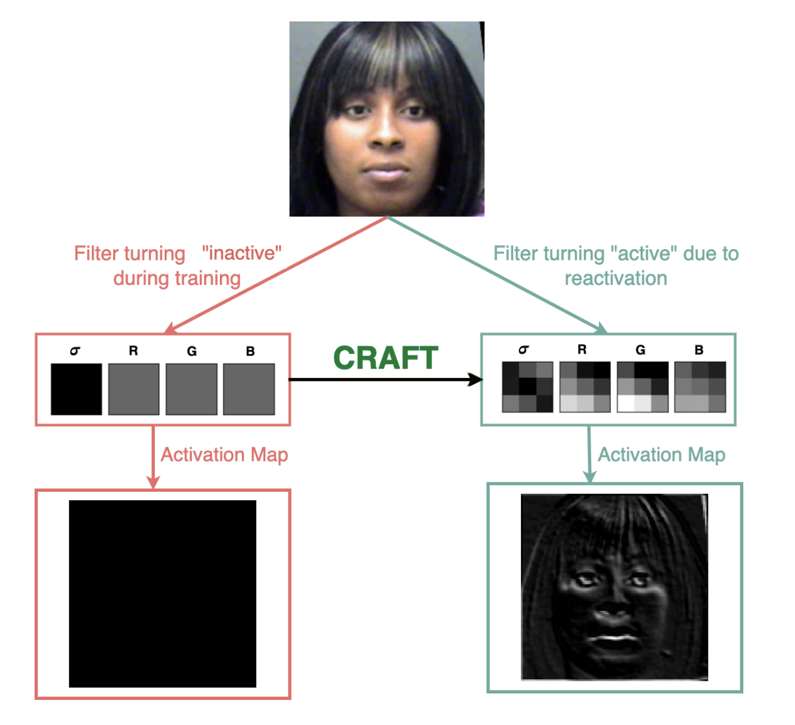
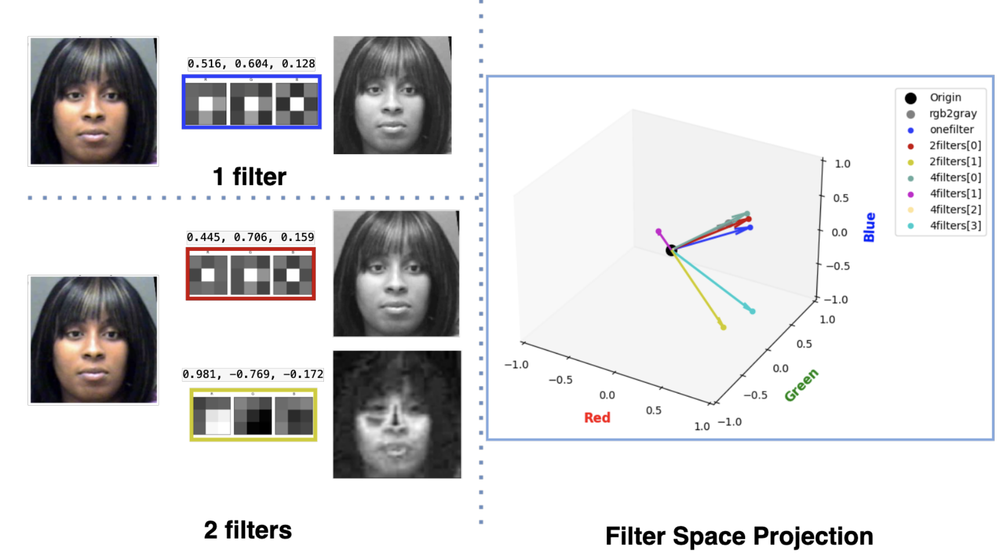
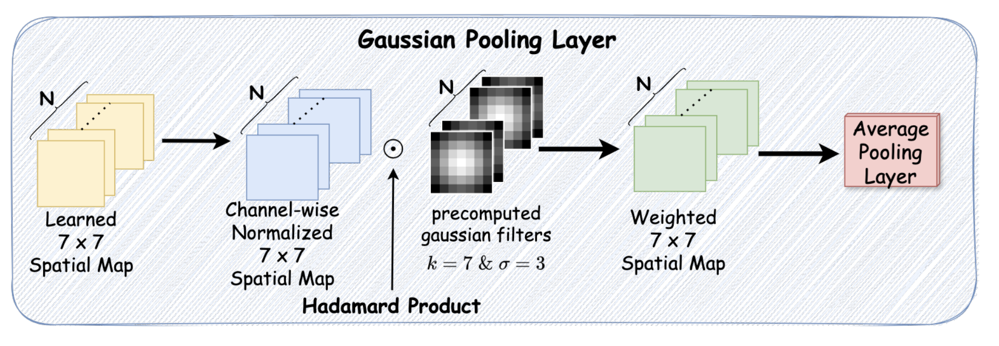
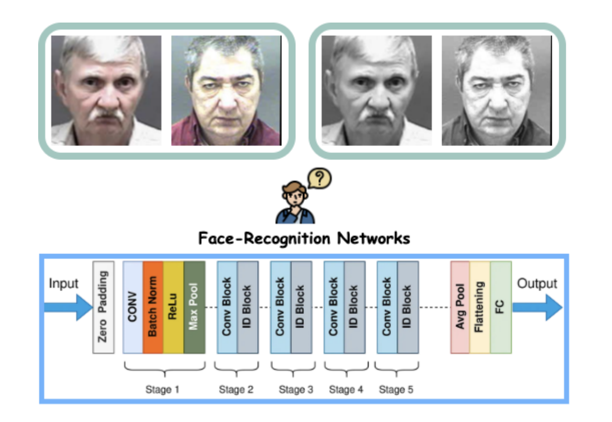
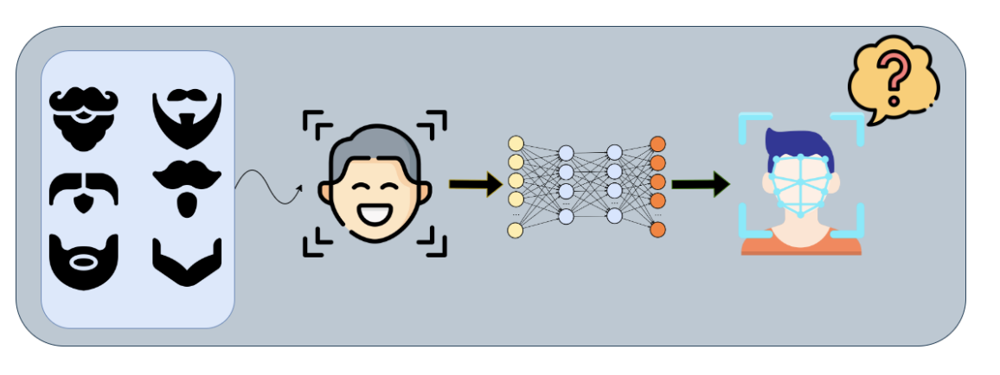

I am an **AI Research Scientist** at [Axon Enterprise Inc.](https://www.axon.com/) in Seattle, WA.

Previously, I was a **Machine Learning Scientist** at [Wayfair](https://www.wayfair.com/) in Boston, MA, where I post-trained multimodal LLMs for fine-grained retrieval, developed cross-encoder rerankers for catalog deduplication, and designed LLM-as-judge pipelines for relevance evaluation — efforts that together powered product discovery and catalog automation at scale. I completed my **Ph.D. in Computer Science and Engineering** at the University of Notre Dame, advised by [Dr. Kevin Bowyer](https://academicweb.nd.edu/~kwb/) at the [Computer Vision Research Lab (CVRL)](https://cvrl.nd.edu/). My doctoral research explored multiple dimensions of face recognition technology, including mitigating bias, optimizing neural networks for efficiency on edge devices, ensuring biometric system security, and improving reliability of face identification search. I also worked on face foundation models with strong text–vision alignment for granular facial attributes. My work has been published at CVPR, ICCV, WACV, FG, IJCB, T-BIOM, and TTS, resulting in 3 patent applications.

I was fortunate to intern at Comcast with the Media Analytics Framework Team in Summer 2024, where I built multimodal models for contextual emotion prediction in video content, leveraging multi-branch transformer architectures, cross-attention mechanisms, and multimodal text encodings.

News
------

* 2026/08: 🎉 Joined Axon Enterprise Inc. as an AI Research Scientist.
* 2026/06: 🏆 Received the <a class="news-award-pill news-award-link" href="https://www.linkedin.com/feed/update/urn:li:activity:7473018582461906944/">Wayfair Technology Rookie of the Year</a> award.
  For contributions to <strong>CaMmo 2.0</strong> (multimodal encoder service) and <strong>Option Grouping</strong> (product grouping service).
  See my manager's view on this — humbled and honored by this recognition.
* 2026/06: 🏆 Our team received the Wayfair Technology Outstanding Technology Team award.  
  Proud to have contributed to the Option Grouping (product grouping) service with this team.
* 2026/03: 📚 2 papers accepted at CVPR'26.
* 2025/12: 🎓 Successfully defended my PhD dissertation. Officially Dr. Bhatta!
* 2025/08: 🎉 Joined Wayfair as ML Scientist.
* 2025/07: 📚 One paper accepted at CV4BIOM@ICCV'25.
* 2025/06: 🎉 Passed AWS Certified Machine Learning Engineer – Associate Exam. See my [badge!](https://www.credly.com/badges/14ecf3d5-c67d-4195-b2ee-e97a0229ec2f/linked_in?t=sy5x72)
* 2025/02: 📚 3 papers accepted at IEEE FG'25. 
* 2025/01: 📚 1 paper accepted at IEEE TBIOM'25. 
* 2024/12: 🎓 Defended my Oral Candidacy. Officially a PhD Candidate Now!
* 2024/06: 📚 1 paper accepted at IEEE IJCB'24.
* 2024/06: 📚 1 paper accepted at IEEE TTS'24.
* 2024/06: 🎉 Started my Internship at Comcast.
* 2024/03: 📚 1 Paper accepted at CVPRW'24.
* 2024/01: 📚 2 Papers accepted at WACV'24.
* 2023/03: 📚 1 Papers accepted at CVPR'23.
* 2023/01: 📚 1 paper accepted to DVPBA@WACV'23.
* 2021/08: 🎓 Started my PhD in CSE Dept. at University of Notre Dame
* 2021/05: 🎓 Graduate from University of Mississippi with B.S (Hons) in Mechanical Engineering
* 2020/01: 🎉 Continuing my Co-op (part-time) for Spring'20 Semester at ThyssenKrupp AG
* 2019/01: 🎉 Started my full-time Engineering Co-op at ThyssenKrupp AG for a year

Timeline
------

  

    

      

        
      

      

        AI Research Scientist
        Axon Enterprise Inc.
        Aug 2026 – Present
      

    

  

  

    

      

        
      

      

        Machine Learning Scientist
        Wayfair
        Aug 2025 – Aug 2026
      

    

  

  

    

      

        
      

      

        Ph.D., Computer Science &amp; Engineering
        University of Notre Dame, CVRL
        Aug 2021 – Dec 2025
      

    

  

  

    

      

        
      

      

        ML Research Intern
        Comcast, Media Analytics Framework
        Jun – Aug 2024
      

    

  

  

    

      

        
      

      

        B.S. (Hons), Mechanical Engineering
        University of Mississippi
        Aug 2016 – May 2021
      

    

  

  

    

      

        
      

      

        Engineering Co-op
        ThyssenKrupp AG
        Jan 2019 – May 2020
      

    

  

Selected Publications
------

  
  

    <strong>Are you In or Out (of gallery)? Wisdom from the Same-Identity Crowd</strong> 
    <strong><u>Aman Bhatta</u></strong>, Maria Dhakal, Michael C. King, Kevin W. Bowyer 
    <em>IEEE / CVF CV4BIOM @ International Conference on Computer Vision </em> (ICCV), 2025. 
    <!-- <a href="[Link to paper]" target="_blank">Paper</a> -->
  

------

  
  

    <strong>Deep CNN Face Matchers Inherently Support Revocable Biometric Templates</strong> 
    <strong><u>Aman Bhatta</u></strong>, Michael C. King, Kevin W. Bowyer  
    <em> IEEE Automatic Face and Gesture Recognition </em> (FG), 2025. (Oral 🏆) 
    <!-- <a href="[Link to paper]" target="_blank">Paper Soon</a> | <a href="https://github.com/abhatta1234/Revocable-Biometrics" target="_blank">Code</a> -->
  

------

  
  

    <strong>CRAFT: Contextual Re-Activation of Filters for face recognition Training</strong> 
    <strong><u>Aman Bhatta</u></strong>, Domingo Mery, Haiyu Wu, Kevin W. Bowyer 
    <em> IEEE Automatic Face and Gesture Recognition </em> (FG), 2025. 
    <!-- <a href="https://arxiv.org/pdf/2312.00072" target="_blank">Paper</a> | <a href="https://github.com/abhatta1234/CRAFT" target="_blank">Code</a> -->
  

------

  
  

    <strong>What's color got to do with it? Face recognition in grayscale</strong> 
     <strong><u>Aman Bhatta</u></strong>, Domingo Mery, Haiyu Wu, Joyce Annan, Michael C. King, Kevin W. Bowyer 
    <em>IEEE Transactions on Biometrics, Behavior, and Identity Science </em> (T-BIOM), 2025. 
    <!-- <a href="https://arxiv.org/pdf/2309.05180" target="_blank">Paper</a> -->
  

------

  
  

    <strong>Revisiting Linearization of Spatial Maps in SoTA Face Recognition Backbone</strong> 
     <strong><u>Aman Bhatta</u></strong>, Haiyu Wu, Kagan Ozturk, Kevin W. Bowyer 
    <em>IEEE International Joint Conference on Biometrics </em> (IJCB), 2024. 
    <!-- <a href="/papers/ijcb24.pdf" target="_blank">Paper</a> -->
  

------

  
  

    <strong>Our Deep CNN Face Matchers Have Developed Achromatopsia</strong> 
     <strong><u>Aman Bhatta</u></strong>, Domingo Mery, Haiyu Wu, Joyce Annan, Michael C. King, Kevin W. Bowyer 
    <em>IEEE / CVF TCV @ Conference on Computer Vision and Pattern Recognition </em> (CVPR), 2024. 
    <!-- <a href="https://openaccess.thecvf.com/content/CVPR2024W/TCV2024/papers/Bhatta_Our_Deep_CNN_Face_Matchers_Have_Developed_Achromatopsia_CVPRW_2024_paper.pdf" target="_blank">Paper</a> -->
  

------

  
  

    <strong>Logical Consistency and Greater Descriptive Power for Facial Hair Attribute
Learning</strong> 
     Haiyu Wu, Grace Bezold, <strong><u>Aman Bhatta</u></strong>, Kevin W. Bowyer 
    <em>IEEE / CVF Computer Vision and Pattern Recognition Conference </em> (CVPR), 2023. 
    <!-- <a href="https://openaccess.thecvf.com/content/CVPR2023/papers/Wu_Logical_Consistency_and_Greater_Descriptive_Power_for_Facial_Hair_Attribute_CVPR_2023_paper.pdf" target="_blank">Paper</a> -->
  

---

Services
------

  

    2026
    

      Pattern Recognition
      CVPR 2026
      NeurIPS 2026
    

  

  

    2025
    

      WACV 2025
      CVPR 2025
      ICCV 2025
      FG 2025
    

  

  

    2024
    

      WACV 2024
      CVPR 2024
      ECCV 2024
    

  

  

    2023
    

      WACV 2023
      IEEE T-IP 2023
      IJCB 2023
    

  

  

    2022
    

      WACV 2022
      ICPR 2022
    

  

